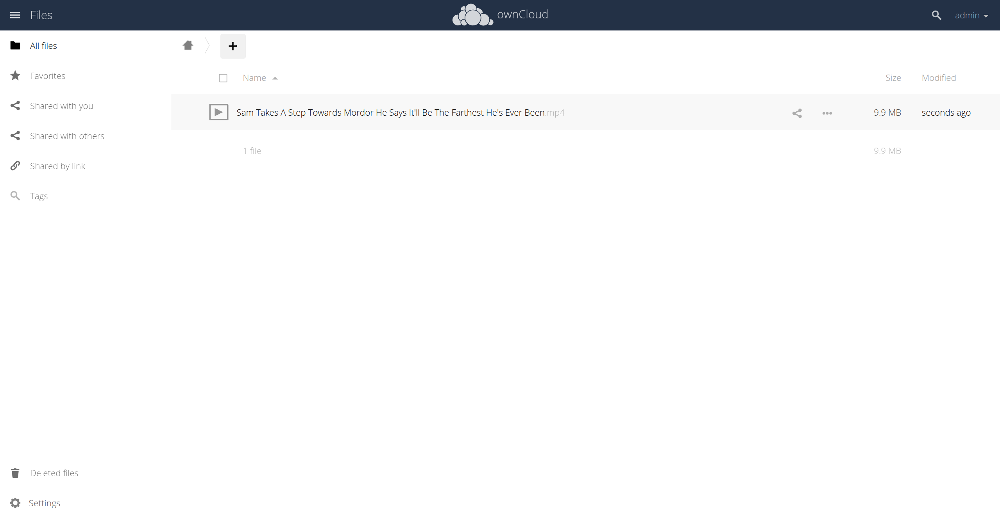
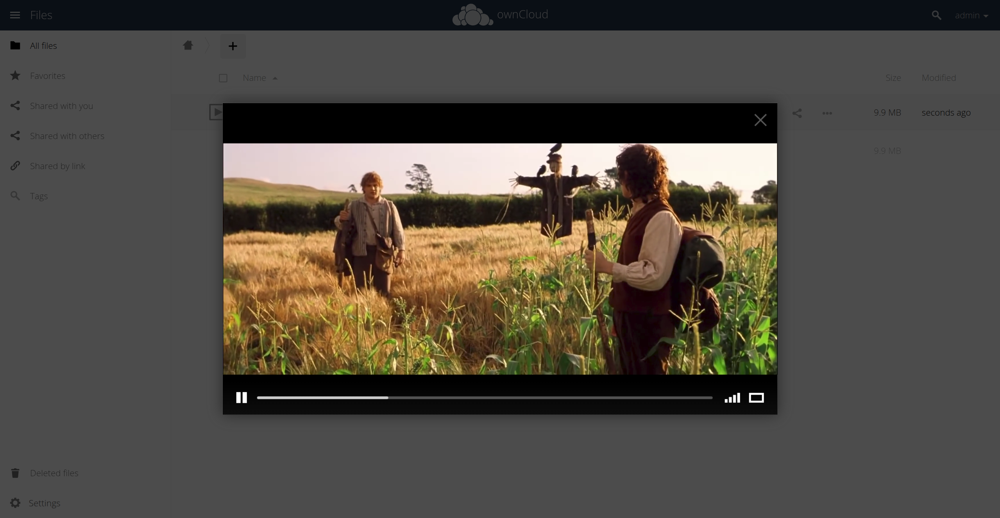

# Proyecto Docker/ownCloud #

## Por qué ##
La **idea** de este proyecto es ejecutar un servicio local de guardado y demanda de archivos *(python http.server maquillado)*, pero **sin tocar el sistema operativo con el que trabajamos**. Usamos docker para aislar todo lo necesario para poder levantar el servidor web. El servidor como tal ya viene como paquete *(o sea, vamos a sentir que somos unos impostores y no hicimos nada... para variar)*, disponible desde los repositorios de docker.

Lo bueno de esto es que **si el servidor crashea por alguna razón, nuestro sistema aún funciona perfectamente** y en el peor de los casos solamente debemos crear un nuevo contenedor y transferir los archivos ahí. También, esto permite (junto a Ansible) crear servidores locales de una manera muy sencilla tan solo con un script como el de *este repositorio*!

El servidor puede accederse mediante la siguiente dirección IP en el navegador

***127.0.0.1:8080*** / ***localhost:8080***

### Cómo Utilizar ###
1. Clone el repositorio utilizando:

        git clone https://github.com/patodev335/Linux-Virtualizacion_Proyecto.git

2. Ejecute el script 

        ./create_server.sh

3. Tras haber creado el contenedor, inicielo utilizando el script

        ./start_server.sh

## Qué es Docker ##
La tecnología Docker utiliza el kernel de Linux y sus funciones, como los grupos de control y los espacios de nombre, para dividir los procesos y ejecutarlos de manera independiente. El propósito de los contenedores es ejecutar varios procesos y aplicaciones por separado para que se pueda aprovechar mejor la infraestructura y, al mismo tiempo, conservar la seguridad que se obtendría con los sistemas individuales.

***Fuente: https://www.redhat.com/es/topics/containers/what-is-docker***

## Qué es ownCloud ##
Es un sistema tipo Google Drive pero autoalojado. Descargué el paquete oficial que ya viene preparado para correrse, con la interfaz web y el backend listos. Usa una base de datos liviana (SQLite) para guardar la metadata de los archivos y los permisos, mientras que los archivos como tal (fotos, txt, etc.) se guardan directo al disco donde está instalado Linux, especificamente en el volumen que se le asignó al contenedor (Docker).

### Datos del servidor ###
    - Usuario: admin
    - Contraseña: admin

***sí, no me maté mucho.***

Igual cuando entren al servidor por primera vez van a poder asignarle su propio usuario y contraseña. Yo recomiendo eso, total es privado.

*Autor: Patricio Nahuel Monsalvo Canosa*

*Fecha: 27/10/2026*